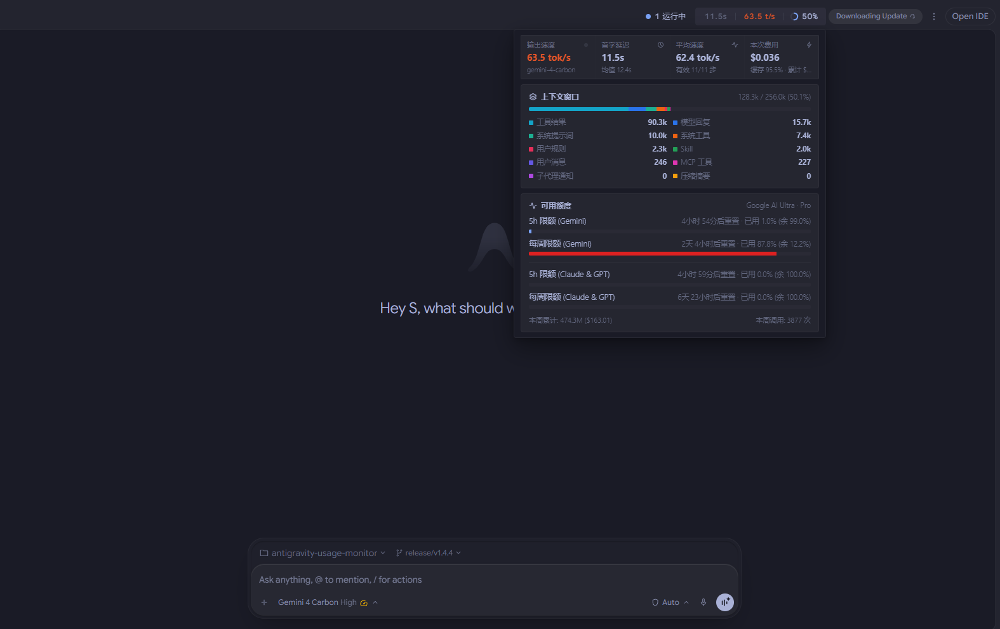
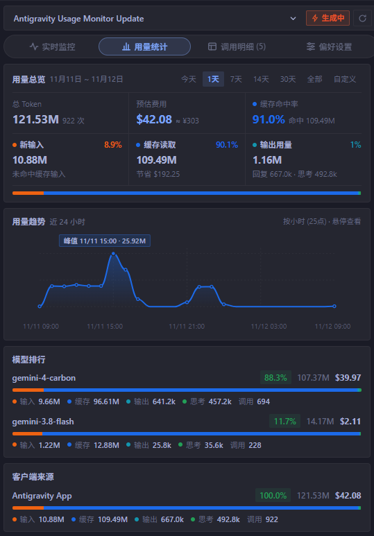
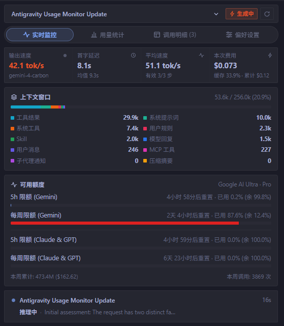
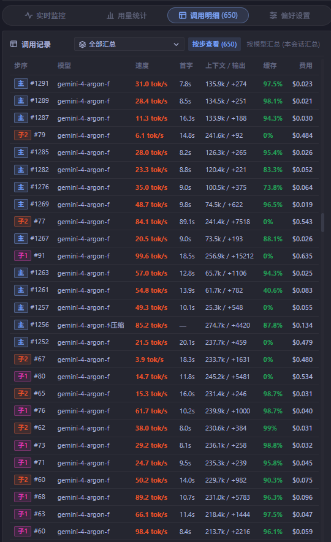

# Antigravity Usage & Speed Monitor

English | [简体中文](README.zh-CN.md)

**Real-time dual-mount monitor for Google Antigravity IDE.**  
Track token generation speed (TPS), time-to-first-token (TTFT), context window usage, official model quotas, subagent activity, and historical token consumption — across Windows, macOS, and Linux.



**[Download Latest Release](https://github.com/yuhuan-dev/antigravity-usage-monitor/releases/latest)** · **[Download ZIP (`usage-monitor.zip`)](https://github.com/yuhuan-dev/antigravity-usage-monitor/releases/latest/download/usage-monitor.zip)**

## Features

- **Real-time Speed Monitoring** — Track live TPS, TTFT, session average generation speed, and estimated step/session API cost.
- **10-Channel Context Window Analysis** — Visualize active context usage across assistant replies, tool results, user messages, subagent notifications, compaction summaries, system prompts, system tools, MCP tools, Skills, and user rules.
- **Model Quota Tracking** — Monitor 5-hour and weekly official quotas across `Gemini`, `Gemini 4 Argon`, `Gemini 4 Carbon`, and `Claude & GPT` pools with live reset countdowns.
- **Subagent Analytics** — Inspect main-agent and subagent calls, context windows, and compaction steps independently or in aggregate.
- **Token Usage Statistics** — Explore historical consumption, cache hit efficiency & savings, interactive trend charts, and model rankings.
- **Dual-Mount Interface** — Run the compact top-bar floating capsule alongside the right-hand side-panel dashboard without modifying `app.asar`.
- **Built-in Cloud Sync & Updates** — Dynamically sync model pricing catalogs and manage 3-tier update modes (`manual` / `auto` / `off`).

### Token Usage Analytics



### Context Window & Quota Monitoring



### Subagent & Step-by-Step Call Details



---

## Panel Overview

The dashboard is organized into four tabs, with a top header to switch conversations, filter by **All / Main Agent / Subagent**, or manually refresh quotas:

- **Live Overview**
  - **Core Metrics**: Output speed (TPS), TTFT, average generation speed, latest step cost, and cumulative session cost (viewable per main agent, per subagent, or combined).
  - **Context Window**: Switchable per agent, decomposed into 10 sources dynamically ordered by token footprint: assistant replies, tool results, user messages, subagent notifications, compaction summaries, system prompts, system tools, MCP tools, Skills, and user rules.
  - **Quota Pools**: Displays 5-hour and weekly limits with reset countdowns for `Gemini`, `Gemini 4 Argon`, `Gemini 4 Carbon` (dedicated pools on Pro accounts), and `Claude & GPT`, plus live multi-session execution cards.
- **Usage Analytics**
  - Filter by Today, 1d, 7d, 14d, 30d, All, or custom date-time ranges.
  - Summarizes total tokens, API-equivalent cost, and cache hit rate, breaking down uncached input, cache reads (including estimated USD saved), and output + thinking usage.
  - Includes an interactive usage trend chart, model rankings, client source distribution, and monthly breakdown bars.
- **Call Details**
  - **By Step**: Lists every step in the selected conversation with its model, TPS, TTFT, context/output tokens, cache hit rate, and step cost.
  - **By Model**: Aggregates call counts, mean speed, total tokens, and cost per model within the current session and selected agent scope.
- **Preferences**
  - **Mount Mode**: Dual-mount (Top Bar + Sidebar) or Sidebar only.
  - **Top-Bar Customization**: Independently toggle the live running-sessions indicator, and customize the content and left-to-right order of the three metric slots in the capsule.
  - **Model Name Format**: Compact short alias (e.g. `argon-4-high`) or raw upstream model ID (e.g. `gemini-3.8-flash-n`), plus an independent Orchestrator series ID selector (`orchestrator-argon` / `worker-agy-hydrogen` compact mode by default, or full annotated IDs).
  - **Version Updates & Pricing Sync**: Dynamically sync [`pricing-catalog.json`](pricing-catalog.json) from GitHub, with three update modes: *Notify only, manual update* (default), *Auto update*, and *Off*.

## Model Identification & Cost Accounting

Model identity is resolved directly from each step's raw usage or matching generator metadata. Automatic context compaction may use a separate model; explicitly recorded models are never overwritten. When a compaction step lacks an explicit model, it is inferred from known steps in the same conversation — preferring preceding, then following provider-compatible steps before relaxing provider constraints. Inferred models are used for display and cost estimation rather than claiming server-confirmed compaction identity; when no evidence is available, the step is marked as unknown compaction.

When a model or its pricing cannot be confirmed, single-step cost is shown as pending while tokens are still counted; aggregate totals sum all steps with confirmed rates. Catalogued models are calculated using public API per-million-token rates for local cost reference only — this does not represent subscription quota deduction ratios.

On upgrade, historical cached entries are re-verified against raw trajectory records. Ambiguous default Argon labels from legacy caches remain unresolved if raw records are temporarily unavailable, while preserving token counts and valid timings. Compaction steps display full-request TPS in step tables but are excluded from session speed and TTFT averages.

## Installation

Keep the plugin folder named `usage-monitor`. No `npm install` is required.

### Option 1: Clone via Git

**Windows (PowerShell)**
```powershell
git clone https://github.com/yuhuan-dev/antigravity-usage-monitor.git "$env:USERPROFILE\.gemini\config\plugins\usage-monitor"
```

**macOS / Linux**
```bash
git clone https://github.com/yuhuan-dev/antigravity-usage-monitor.git ~/.gemini/config/plugins/usage-monitor
```

Or ask Antigravity directly in chat:
```text
Clone https://github.com/yuhuan-dev/antigravity-usage-monitor to ~/.gemini/config/plugins/usage-monitor and enable the plugin
```

### Option 2: Download & Extract ZIP

Download [`usage-monitor.zip`](https://github.com/yuhuan-dev/antigravity-usage-monitor/releases/latest/download/usage-monitor.zip) and extract it into `~/.gemini/config/plugins/`.

**Windows PowerShell:**
```powershell
$pluginsDir = "$env:USERPROFILE\.gemini\config\plugins"
New-Item -ItemType Directory -Path $pluginsDir -Force | Out-Null
Invoke-WebRequest -Uri "https://github.com/yuhuan-dev/antigravity-usage-monitor/releases/latest/download/usage-monitor.zip" -OutFile "$env:TEMP\usage-monitor.zip"
Expand-Archive -Path "$env:TEMP\usage-monitor.zip" -DestinationPath $pluginsDir -Force
```

## Enabling & Opening the Panel

1. Open **Customizations** in the left sidebar, switch to the **Installed** tab, locate `usage-monitor`, and toggle it on.
2. **Top-Bar Floating Capsule (enabled by default)**: Once enabled, the background sidecar mounts a live status & metric capsule in the top-right bar of the main chat window (hover for quick overview, left-click to expand the full 4-tab panel, right-click to force refresh) without modifying `app.asar`. To disable the top-bar capsule, switch **Mount Mode** to *Sidebar only* in Preferences.
3. **Right-Hand Sidebar Panel**: Click `⋮` in the top-right corner of the chat pane -> **Extensions** -> **Usage & Speed Monitor** (or **用量监控**) to dock the panel in the auxiliary sidebar.

## Updating

The plugin includes built-in cloud version checks and one-click self-updating:
- When a new release is available, a subtle update badge appears next to the top-bar capsule and inside the panel header — click it to pull the update and reload automatically, or manage update behavior and pricing catalog sync in **Preferences -> Version Updates**.

To update manually from the command line:
- **Git installations** — pull the latest fast-forward commits and toggle the plugin off/on in **Customizations -> Installed**:

```powershell
# Windows PowerShell
git -C "$env:USERPROFILE\.gemini\config\plugins\usage-monitor" pull --ff-only
```

```bash
# macOS / Linux
git -C ~/.gemini/config/plugins/usage-monitor pull --ff-only
```

- **ZIP installations** — download the new `usage-monitor.zip`, extract over the existing folder, and toggle the plugin off/on. Local caches and user settings are stored separately in `~/.gemini/antigravity/sidecar_data/usage-monitor/` (or `sidecars/panel/.data/` when run standalone), so updating never erases historical usage data.

## Local Development

After editing frontend source files under `sidecars/panel/src/`, rebuild `app.js` and `styles.css` from `sidecars/panel`:

```bash
npm run build
```

Run the model identity, cache migration, quota pool, and timing regression test suite (zero external dependencies required):

```bash
npm test
```
