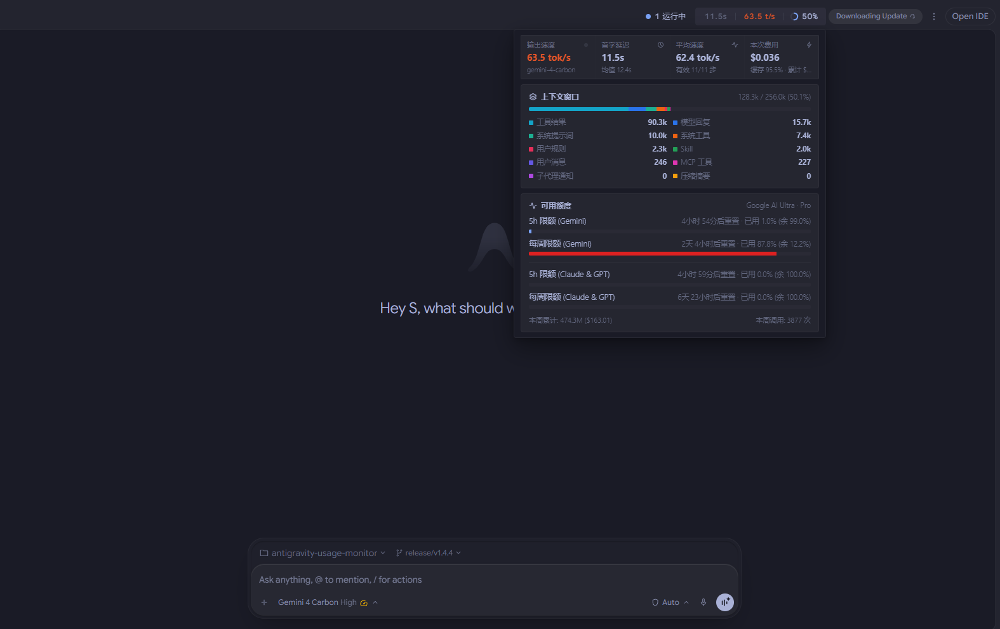
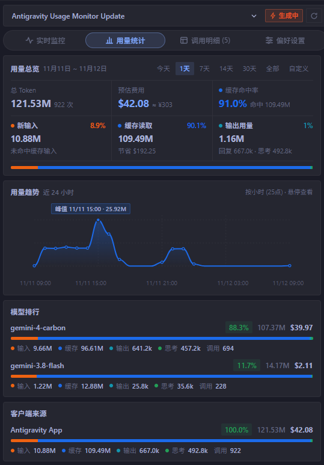
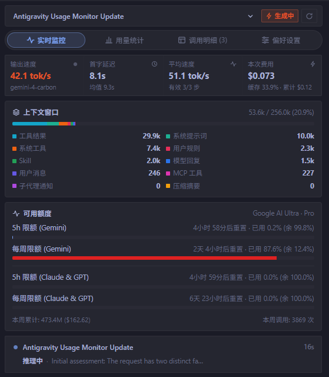
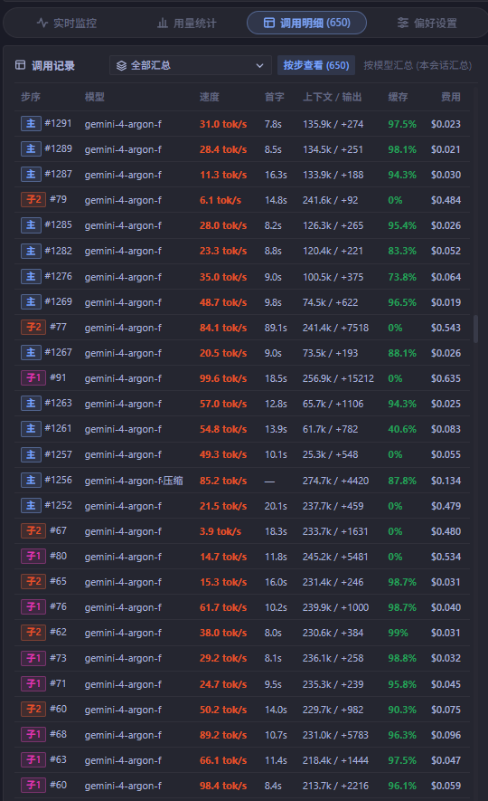

# Antigravity Usage & Speed Monitor

[English](README.md) | 简体中文

**Google Antigravity IDE 实时双栖监控插件。**  
一站式查看生成速度（TPS）、首字延迟（TTFT）、十维上下文窗口占用、官方模型配额、子代理追踪与历史 Token 消耗（支持 Windows / macOS / Linux）。



**[下载最新版本 (Releases)](https://github.com/yuhuan-dev/antigravity-usage-monitor/releases/latest)** · **[直接下载压缩包 (`usage-monitor.zip`)](https://github.com/yuhuan-dev/antigravity-usage-monitor/releases/latest/download/usage-monitor.zip)**

## 核心特性

- **实时速度监控** — 追踪实时输出速度（TPS）、首字延迟（TTFT）、会话平均速度以及单步/累计折算费用。
- **十维上下文窗口拆解** — 直观查看模型回复、工具结果、用户消息、子代理通知、压缩摘要、系统提示词、系统工具、MCP 工具、Skill 与用户规则的实时占用比例。
- **多池模型额度追踪** — 同步展示 `Gemini`、`Gemini 4 Argon`、`Gemini 4 Carbon` 与 `Claude & GPT` 模型池的 5 小时限额、每周限额及重置倒计时。
- **主代理与子代理独立统计** — 支持全局汇总或单独切换查看主代理与任意子代理的调用明细、上下文窗口及压缩步骤。
- **历史 Token 用量统计** — 按多时间维度统计 Token 消耗、缓存命中率与节省金额、交互式趋势曲线及模型费用排行。
- **顶部栏 + 侧边栏双栖挂载** — 主窗口右上角悬浮胶囊与右侧辅助栏面板协同工作，全程不修改宿主 `app.asar`。
- **内置价格同步与版本更新** — 支持云端动态同步模型价格表，并提供手动提示更新、自动更新与关闭更新三档模式。

### 历史用量与趋势统计



### 上下文窗口与模型配额



### 主代理与子代理调用明细



---

## 功能概览

面板分为四个标签页，顶部可切换要查看的会话、按全部/主代理/子代理筛选或手动刷新配额：

- **实时监控**
  - 核心指标：输出速度、首字延迟、平均速度、本次费用与会话累计费用（支持主代理与子代理独立或汇总查看）。
  - 上下文窗口：支持按代理独立切换查看当前上下文窗口，并拆分为模型回复、工具结果、用户消息、子代理通知、压缩摘要、系统提示词、系统工具、MCP 工具、Skill 与用户规则十类来源（按占用量从大到小动态排列）。
  - 额度概览：同步展示 `Gemini`、`Gemini 4 Argon`、`Gemini 4 Carbon`（Pro 账号独立池）与 `Claude & GPT` 模型池的 5 小时限额、每周限额及重置倒计时。
- **用量统计**
  - 支持按今天、1天、7天、14天、30天、全部或自定义时间段过滤。
  - 汇总所选时段的总 Token、折算费用与缓存命中率，并分列展示新输入、缓存读取（含缓存节省金额）与输出用量。
  - 包含用量趋势曲线、模型排行、客户端来源以及月度统计柱状图。
- **调用明细**
  - 按步查看：列出当前会话全部步骤的模型、输出速度、首字延迟、上下文/输出 Token、缓存命中率与单步费用。
  - 按模型汇总：按当前所选会话（及所选主/子代理范围）统计各模型的调用次数、均速、总 Token 与费用。
- **偏好设置**
  - 选择面板挂载方式：双栖挂载（顶部栏 + 侧边栏）或仅侧边栏。
  - 顶部栏定制：独立开关实时运行会话入口，并自由定义右侧三个指标槽位的显示内容与排列顺序。
  - 选择模型名称格式：精简代号或原始模型 ID。
  - 版本更新与价格表同步：支持从云端 [`pricing-catalog.json`](pricing-catalog.json) 动态同步最新模型价格表，并提供「仅提示新版本，手动更新」（默认）、「自动更新」与「关闭更新」三档更新方式。

## 模型识别与费用口径

模型优先取自当前步骤的原始用量或对应生成记录。自动压缩可能使用独立模型；明确记录的模型不会被覆盖。压缩步骤缺少模型时，会从同一会话中有明确模型的步骤推断：优先查找此前、其次此后的提供方兼容步骤，找不到时再放宽提供方限制。推断结果用于模型展示和费用估算，并不代表服务端已确认压缩模型；没有可用记录时显示“模型未知·压缩”。

模型或价格未能确认时，单步费用显示“待定”，Token 仍计入统计；汇总费用累加所有已确认单价的步骤。模型明确且价格表已收录的步骤继续按本地 API 单价折算；这不代表订阅额度的美元换算关系。

升级时会重新读取旧缓存的原始记录。旧版默认填入的 Argon 标签无法与真实 Argon 区分；原始记录暂时无法读取时，该标签会暂记为未知，Token 和已有有效计时保留。压缩步骤可显示完整请求 TPS，但不进入会话均速。

## 安装

插件目录名需保持为 `usage-monitor`，无需运行 `npm install`。

### 方式一：通过 Git 克隆

**Windows**
```powershell
git clone https://github.com/yuhuan-dev/antigravity-usage-monitor.git "$env:USERPROFILE\.gemini\config\plugins\usage-monitor"
```

**macOS / Linux**
```bash
git clone https://github.com/yuhuan-dev/antigravity-usage-monitor.git ~/.gemini/config/plugins/usage-monitor
```

也可以直接在 Antigravity 对话框中让 AI 执行安装：
```text
把 https://github.com/yuhuan-dev/antigravity-usage-monitor 克隆到 ~/.gemini/config/plugins/usage-monitor 并启用插件
```

### 方式二：下载压缩包解压

下载 [usage-monitor.zip](https://github.com/yuhuan-dev/antigravity-usage-monitor/releases/latest/download/usage-monitor.zip)，解压到 `~/.gemini/config/plugins/` 目录下。

Windows PowerShell 命令：
```powershell
$pluginsDir = "$env:USERPROFILE\.gemini\config\plugins"
New-Item -ItemType Directory -Path $pluginsDir -Force | Out-Null
Invoke-WebRequest -Uri "https://github.com/yuhuan-dev/antigravity-usage-monitor/releases/latest/download/usage-monitor.zip" -OutFile "$env:TEMP\usage-monitor.zip"
Expand-Archive -Path "$env:TEMP\usage-monitor.zip" -DestinationPath $pluginsDir -Force
```

## 启用与打开面板

1. 打开左侧边栏的 **Customizations**，进入 **Installed** 标签页，找到 `usage-monitor` 并开启。
2. **顶部栏胶囊悬浮面板（默认双栖开启）**：开启插件后，后台 Sidecar 会自动在主对话窗口右上角顶部栏挂载实时状态与指标胶囊（悬停查看速览，左键展开完整四标签面板，右键强制刷新），全程不修改宿主 `app.asar`。如需关闭顶部栏胶囊，可在 **偏好设置 -> 面板挂载方式** 中切换为「仅侧边栏」。
3. **右侧辅助栏面板**：点击对话窗口右上角 `⋮` -> **Extensions** -> **用量监控**，在右侧辅助栏展开面板；或在对话中输入「打开用量监控面板」通过快捷入口唤起。

## 更新

插件内置了云端版本检测与一键更新支持：
- 当检测到新版本时，顶部栏胶囊旁与面板顶部会显示柔和的新版本提示徽章，点击即可自动拉取更新并重启面板；也可在 **偏好设置 -> 版本更新** 中切换更新方式（仅提示新版本手动更新 / 自动更新 / 关闭更新）或手动同步价格表。

如需通过命令行手动更新：
- 通过 Git 安装时，拉取最新代码后在 **Customizations -> Installed** 中重新开关一次插件即可：

```powershell
# Windows PowerShell
git -C "$env:USERPROFILE\.gemini\config\plugins\usage-monitor" pull --ff-only
```

```bash
# macOS / Linux
git -C ~/.gemini/config/plugins/usage-monitor pull --ff-only
```

通过压缩包安装时，下载新版 `usage-monitor.zip` 覆盖解压到原目录后重新开关插件即可。在 Antigravity 宿主内运行时，本地缓存与设置存放在 `~/.gemini/antigravity/sidecar_data/usage-monitor/`（独立启动且未传入 `ANTIGRAVITY_EXECUTABLE_DATA_DIR` 时回退至 `sidecars/panel/.data/`），更新插件不会清除历史数据。

## 本地构建

如果修改了 `sidecars/panel/src/` 下的前端源码，可在 `sidecars/panel` 目录下运行以下命令重新生成 `app.js` 与 `styles.css`：

```bash
npm run build
```

运行模型识别、缓存迁移与计时回归测试（无需额外安装依赖）：

```bash
npm test
```
